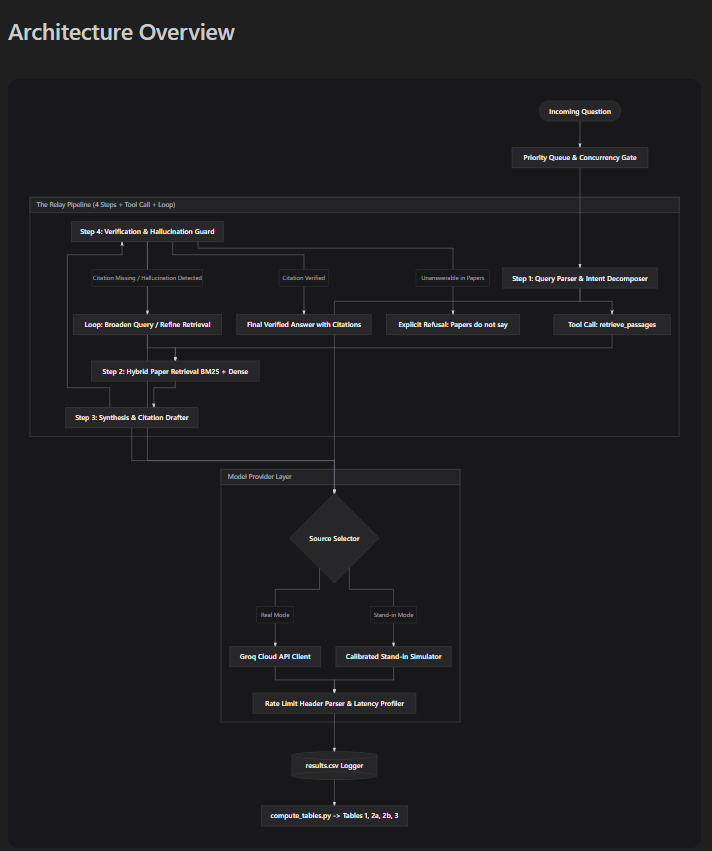

# The Relay: Resilient Research Paper Assistant

[]()
[]()
[]()

A resilient LLM pipeline and benchmarking system for answering technical queries over three research papers under strict rate limits (RPM, TPM, RPD) and bursty traffic loads.

---

## 📚 The Paper Library
The assistant strictly answers from these three arXiv papers (fetched at exact specified versions):
1. **"Attention Is All You Need"** — `arXiv:1706.03762v7`
2. **"Moshi: a speech-text foundation model for real-time dialogue"** — `arXiv:2410.00037v1`
3. **"Dynamic Chunking for End-to-End Hierarchical Sequence Modeling"** — `arXiv:2507.07955v2`

---

## 🚀 Architecture Overview



- **4-Step Decoupled Pipeline:**
  1. *Query Parser & Decomposer* — Extracts entities, detects out-of-scope queries, routes target hints.
  2. *Passage Retrieval Tool* — True hybrid retrieval: BM25 lexical search + dense semantic vectors (SentenceTransformer) combined via Reciprocal Rank Fusion (RRF). Supports on-disk vector caching.
  3. *Synthesis & Citation Drafter* — Generates answers with grounded section/page citations; strictly refuses when evidence is absent. Supports non-streaming and end-to-end token streaming.
  4. *Citation Verification & Factual Guard* — Validates citation existence against corpus page boundaries, extracts evidence claims, and triggers an automated feedback loop for reformulation.
- **GroqCloud Provider & Calibrated Stand-in Simulator:**
  - Real Provider: GroqCloud API (`api.groq.com/openai/v1`) using model `openai/gpt-oss-20b` (following the decommissioning of legacy `llama-3.3-70b-versatile` on August 16, 2026).
  - Stand-in Simulator: Calibrated offline simulator strictly for offline tests (`LLM_PROVIDER=standin` or `--source stand-in`).
  - **Zero Silent Fallback:** In Groq mode, network or rate-limit failures are surfaced explicitly; the system never silently masks errors with stand-in results.
- **Adaptive Retrieval Degradation:**
  - Automatically downscales retrieval context (Setting B $\to$ Setting A) when upstream rate limits or 429 retries occur, cutting token burn by ~70%.
- **Local Quota Limiting & Concurrency Control:**
  - `LocalQuotaLimiter` protects runtime requests by reserving estimated input and output tokens before calls, enforcing RPM, TPM, RPD, and TPD local caps, and reconciling actual tokens after response completion.
  - Bounded concurrent scheduler dispatches requests at target start-to-start intervals (1.0s) independently of individual query processing durations.

---

## 🛠️ Quick Start

### 1. Clone & Install Dependencies
```bash
git clone https://github.com/Udbhaw08/the-relay.git
cd the-relay
pip install -r requirements.txt
```

### 2. Configure Environment
Create a `.env` file from `.env.example`:
```bash
cp .env.example .env
```
Fill in your Groq API key (`GROQ_API_KEY=...` and optionally `GROQ_MODEL=openai/gpt-oss-20b`). Note: Free tier only; do not configure paid tiers.

### 3. Run Automated Tests
```bash
pytest -v
```
*(All 129 offline unit and integration tests pass; 1 opt-in live test is skipped by default).*

### 4. Interactive CLI (`scripts/ask.py`)
Run an answerable query using the offline stand-in:
```bash
python scripts/ask.py --source stand-in "What is the formula for Scaled Dot-Product Attention in Attention Is All You Need?"
```

Run with real-time token streaming:
```bash
python scripts/ask.py --source stand-in --stream "What is the formula for Scaled Dot-Product Attention in Attention Is All You Need?"
```

Test negative-control refusal:
```bash
python scripts/ask.py --source stand-in "What specific 16,000 H100 GPU cluster networking topology was used to train the Llama-3 405B base model?"
```

### 5. Interactive Streamlit Dashboard
Launch the web interface with streaming response visualization and telemetry metrics:
```bash
streamlit run dashboard/app.py
```

### 6. Execute Full Benchmark Suite
Run the reproducible benchmark runner (preserves historical results and records run-scoped artifacts to `data/runs/<run_id>/`):
```bash
python scripts/run_benchmarks.py --offline-only --seed 42 --run-id phase9_final_verified
```
This runs:
- Steady load scenario with start-to-start pacing
- Retrieval setting benchmarks (Settings A, B, and C) with independent context and isolated quotas
- Load scenarios (`burst`, `sustained_overload`, `per_minute_limit_halved`, `daily_budget_exhausted`)
- Logs results to `data/runs/<run_id>/results.csv` and captures configuration snapshot in `data/runs/<run_id>/manifest.json`
- Generates Tables 1, 2a, 2b, and 3.

### 7. Inspect Results & Validate Schema
```bash
python scripts/compute_tables.py --csv data/runs/phase9_final_verified/results.csv --validate
```

### 8. Verify Submission Report 2-Page Fit
```bash
python scripts/verify_pdf_page_count.py
```

---

## 🔒 Groq Status & Safety Rules
- **Provider Status:** GroqCloud is the ONLY real provider configured.
- **Credential Safety:** The friend's key status is `UNVERIFIED` (authorization not received and Free-plan tier unconfirmed). Live API calls remain blocked by default.
- **Opt-in Live Smoke Testing:** Running a live call requires explicit confirmation flags:
  ```bash
  python scripts/smoke_test_groq.py --confirm-free-tier --authorized
  ```

---

## 📄 Submission Report
Read the condensed 2-page engineering submission document at [`docs/SUBMISSION_REPORT.md`](docs/SUBMISSION_REPORT.md) (PDF rendering verified at [`docs/SUBMISSION_REPORT.pdf`](docs/SUBMISSION_REPORT.pdf)). Complete technical traces and appendices are in [`docs/implementation/FINAL_REPORT.md`](docs/implementation/FINAL_REPORT.md).
