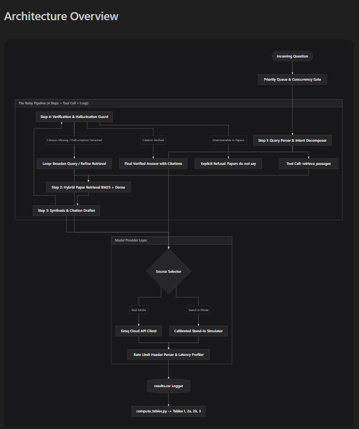
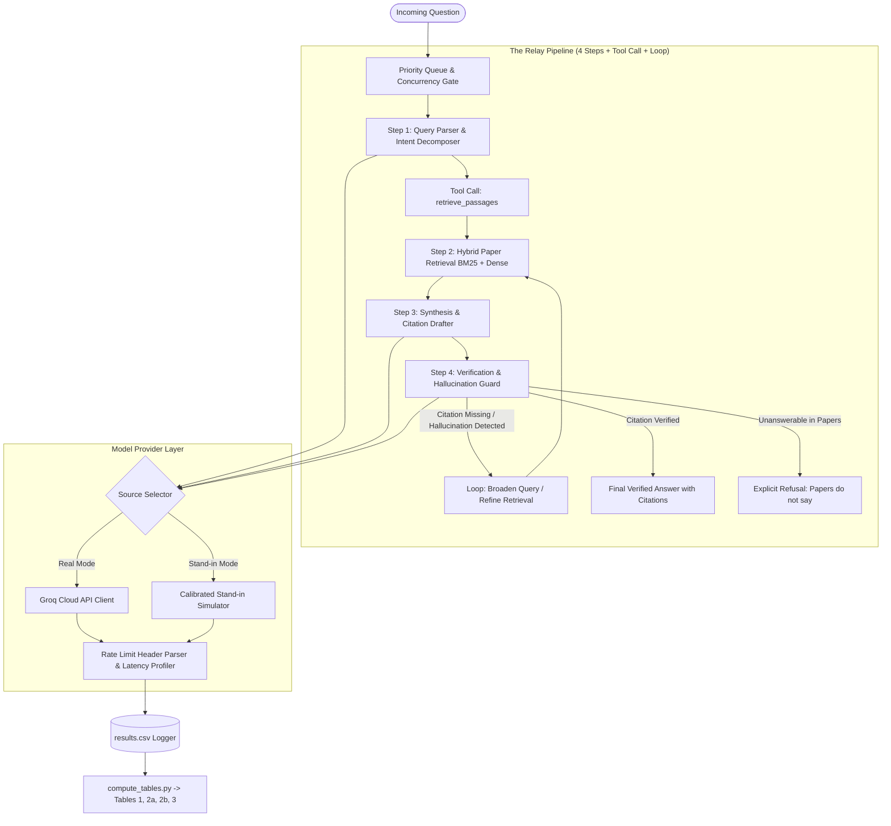

# The Relay: Resilient Research Paper Assistant
## Architecture, Systems Design & Implementation Plan

---

### System Architecture Overview

---

### The Three Required arXiv Papers
1. **Attention Is All You Need** — `arXiv:1706.03762v7`
2. **Moshi: a speech-text foundation model for real-time dialogue** — `arXiv:2410.00037v1`
3. **Dynamic Chunking for End-to-End Hierarchical Sequence Modeling** — `arXiv:2507.07955v2`

---

### Multi-Step Pipeline Lifecycle (4 Steps + 1 Tool Call + 1 Loop/Branch)
1. **Step 1: Query Parser & Intent Decomposer**
   - Extracts key entities, target paper candidates, and expected detail depth.
   - Determines if the question asks for out-of-scope information.
2. **Step 2: Context Retrieval (Tool Call: `retrieve_passages`)**
   - Executes hybrid retrieval (BM25 lexical + dense vector embeddings).
   - Dynamically adapts chunk extraction based on active setting (`setting_a`, `setting_b`, `setting_c`).
3. **Step 3: Synthesis & Citation Drafter**
   - Synthesizes answers strictly supported by retrieved passages.
   - Appends explicit citations in the format `[Paper Title, Section, Page]`.
   - If the retrieved text lacks the answer, explicitly outputs refusal without guessing.
4. **Step 4: Verification & Hallucination Guard (Loop-Back / Branch)**
   - Validates each citation against the source chunk text.
   - **Branch / Loop condition**: If a citation fails verification or context is incomplete, triggers a single-shot query reformulation loop (Step 2).
   - If still unverified, drops ungrounded statements or branches to a verified partial response.

---

### Multi-Provider Model Strategy & Calibrated Stand-In
- **Primary Provider**: Gemini 2.0 / 1.5 Flash (15 RPM, 1,500 RPD, 1M TPM).
- **Secondary / Fallback Provider**: NVIDIA NIM (Llama-3.3-70B-Instruct).
- **Stand-In Simulator**:
  - Calibrated against real service measurements (Time to First Token, token generation velocity).
  - Simulates queueing latency, load degradation under concurrency, rate limits (RPM / RPD / TPM), and HTTP 429 status codes with `retry-after` delays.
  - Used for heavy burst and sustained overload tests where free-tier quotas would be immediately exhausted.

---

### Retrieval Experiments Matrix (Table 3)
| Setting | Piece Size | Pieces Fetched | Re-ranking | Target Trade-off |
| :--- | :--- | :--- | :--- | :--- |
| **Setting A** | 250 tokens | 3 pieces | No (Pure BM25/Dense) | Ultra-low latency, minimal token consumption |
| **Setting B** | 500 tokens | 5 pieces | Yes (Hybrid BM25 + Dense) | Balanced recall, precision, and token cost |
| **Setting C** | 1000 tokens | 7 pieces | Yes (Dense + Cross-Score) | Deep context, higher recall, higher token cost |

---

### Traffic Scenarios & Benchmarks (Table 2a & 2b)
1. **Steady**: Constant Poisson arrivals within rate limits.
2. **Burst**: Sudden spike of concurrent requests.
3. **Sustained Overload**: Continuous rate exceeding provider RPM.
4. **Per-Minute Limit Halved**: Quota reduced to test dynamic throttle backoff.
5. **Daily Budget Exhausted**: Simulates hitting daily quota at 3 PM and serving graceful notifications.

---

### Submission Deliverables Checklist
- [x] Private GitHub repository connected.
- [ ] Working Python pipeline with tests (`pytest`).
- [ ] 3 arXiv papers ingested at exact specified versions.
- [ ] Calibrated Stand-in model service.
- [ ] Automated evaluation of 15 benchmark questions.
- [ ] `results.csv` containing all request rows and telemetry.
- [ ] `scripts/compute_tables.py` computing Tables 1, 2a, 2b, and 3.
- [ ] 2-Page Executive Report (`docs/SUBMISSION_REPORT.md`) matching all 8 headings + 3 additional sections.

